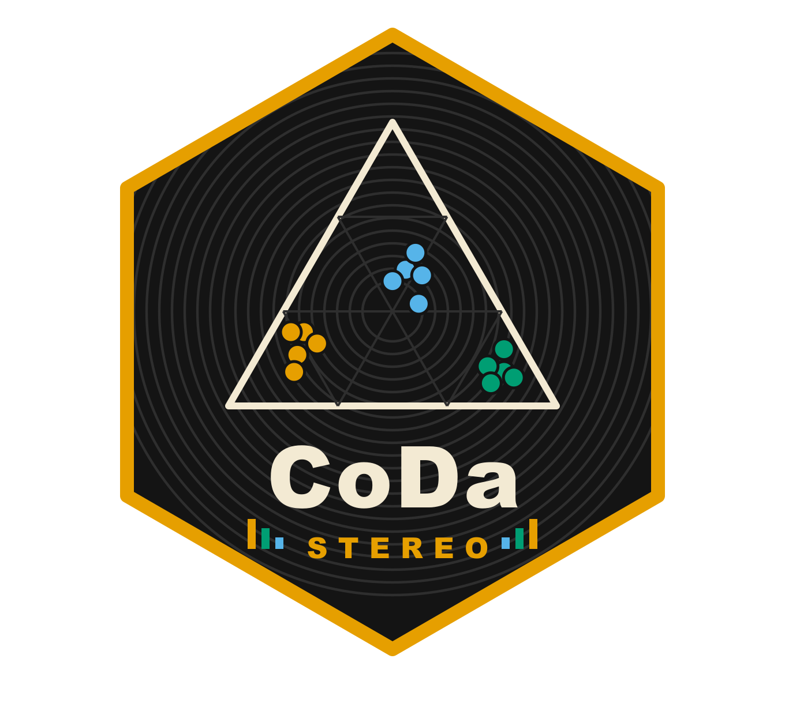

<p align="center">
  
</p>

# CoDa Stereo  

<!-- badges: start -->
[](https://opensource.org/licenses/MIT)
<!-- badges: end -->

> **Compositional Data Analysis for Stereological, Histomorphometric and Blood-Cell Data**
>
> A Shiny application implementing the Aitchison geometry for the full
> data analysis cycle: data upload, zero/NA handling, compositional
> visualisation, balances, and permutational MANOVA with post-hoc tests.
>
> Developed alongside:
> Provete, D.B., Severgnini, M.R., Fernandes, C.E. & Franco-Belussi, L.
> *A Practical Guide to using Compositional Data Analysis in Tissue Stereology
> and Blood Cell Profile*. **Physiological Reports** (in review).

See [NEWS.md](NEWS.md) for the changes in each version.

---

## Features

| Module | Capabilities |
|---|---|
| **Data Upload** | CSV and Excel (.xlsx/.xls) with sheet selector; smart parts selector that auto-excludes ID columns |
| **Data Inspection** | Zero/NA heatmap (observed vs. structural zero vs. missing); `naniar::vis_miss` plot; counts per part |
| **Zero Handling** | Three methods via `zCompositions`: CZM (count zeros), multRepl (rounded zeros), lrEM (rounded zeros); NA handling via listwise deletion or geometric-mean imputation |
| **Compositional Analysis** | Manual ternary plot (pure ggplot2, no ggtern dependency); amalgamation of D > 3 parts into 3 groups; clr-PCA biplot on unscaled clr coordinates with a "how to read" note; compositional centre and total variance per group; selectable colour palettes (Okabe-Ito, Dark2, viridis) |
| **Balances (SBP)** | Automatic sequential binary partition (Ward clustering on clr distances), editable cell by cell with on-the-fly validation; balance definitions table; CoDa dendrogram with per-group boxplots |
| **Statistical Modeling** | Factorial permutational MANOVA via `RRPP::lm.rrpp`; optional log-total as an extra coordinate (composition + total; Pawlowsky-Glahn, Egozcue & Lovell 2015) with a warning when totals are fixed by design; pairwise post-hoc via `RRPP::pairwise`; residual diagnostics; formula preview before fitting |
| **Downloads** | Ternary, biplot and CoDa dendrogram as PDF; imputed data, SBP, ANOVA and pairwise tables as CSV |

## Installation

### Run locally (recommended for development)

```r
# Install from GitHub
# install.packages("devtools")
devtools::install_github("diogoprov/CoDaStereo")

# Launch
CoDaStereo::run_app()
```

### Run without installing (quick start)

```r
# Clone the repo, then:
setwd("CoDaStereo/")
pkgload::load_all()
run_app()
```

### Dependencies

CoDaStereo depends on: `shiny`, `shinydashboard`, `rintrojs`, `dplyr`,
`tidyr`, `tibble`, `purrr`, `ggplot2`, `scales`, `readxl`, `naniar`,
`compositions`, `zCompositions`, `RRPP`, `factoextra`, `FactoMineR`,
`golem`, `rlang`.

All are available on CRAN.

---

## Deploy to Posit Connect Cloud (free)

Connect Cloud is Posit's next-generation hosting platform. It deploys
directly from a public GitHub repository with automatic push-to-publish.

### Step-by-step

1. **Fork or push this repository** to your GitHub account.

2. **Generate `manifest.json`** — this file tells Connect Cloud which R
   version and packages to use. Run this once in your local R session
   (from the repository root):

   ```r
   # install.packages("rsconnect")
   # list only the files the deployed app needs
   f <- system("git ls-files", intern = TRUE)
   f <- f[grepl("^(app[.]R|DESCRIPTION|NAMESPACE|LICENSE|R/|www/|inst/)", f)]
   rsconnect::writeManifest(appDir = ".", appFiles = f, appPrimaryDoc = "app.R")
   ```

   Commit and push the generated `manifest.json`.

3. **Sign in to [Connect Cloud](https://connect.posit.cloud/)**
   with your GitHub account.

4. **Click "Publish"** (+ icon at the top), select your repository and
   branch (`main`). Connect Cloud will detect `app.R` and deploy
   automatically.

5. **Get a shareable URL** — share it in your manuscript or
   supplementary materials.

### Updating the app

After the initial setup, every `git push` to `main` triggers an
automatic re-deploy. No manual steps needed.

### Alternative: deploy from RStudio

```r
# One-time authentication (opens browser)
rsconnect::connectCloudUser()

# Deploy
rsconnect::deployApp(appDir = ".", appName = "CoDaStereo")
```

---

## Repository structure

```
CoDaStereo/
├── app.R                  # Entry point for Posit Connect Cloud
├── DESCRIPTION, NAMESPACE, LICENSE, NEWS.md
├── manifest.json          # Generated by rsconnect::writeManifest()
├── R/
│   ├── run_app.R          # golem entry point: run_app()
│   ├── app_ui.R           # Dashboard layout (assembles modules)
│   ├── app_server.R       # Wires module reactives
│   ├── fct_helpers.R      # Helpers: zeros, ternary plot, palettes, SBP, total, clr-PCA
│   ├── mod_data.R         # Upload, parts selector, inspection
│   ├── mod_imputation.R   # Zero/NA imputation
│   ├── mod_analysis.R     # Ternary, biplot, descriptives
│   ├── mod_balances.R     # SBP editor and CoDa dendrogram
│   ├── mod_stats.R        # MANOVA (with optional total), pairwise, diagnostics
│   └── mod_tutorial.R     # Guided tour (rintrojs)
├── tests/testthat/        # Unit and module tests
├── vignettes/             # Getting started
├── inst/logo/             # Hex sticker (SVG, PNG)
├── dev/                   # Development scripts (run_dev.R, make_sticker.py)
└── .github/workflows/     # R CMD check on Linux, macOS and Windows
```

## How to cite

If you use CoDaStereo in your research, please cite both the paper and
the software:

```bibtex
@article{provete2026codastreo,
  author  = {Provete, Diogo B. and Severgnini, Marcos R. and Fernandes, Carlos E. and Franco-Belussi, Lilian},
  title   = {A Practical Guide to using Compositional Data Analysis in Tissue Stereology and Blood Cell Profile},
  journal = {Physiological Reports},
  year    = {2026},
  note    = {In review}
}

@software{provete2026codastreo_app,
  author  = {Provete, Diogo B.},
  title   = {{CoDa Stereo}: Compositional Data Analysis for Stereological Data},
  year    = {2026},
  url     = {https://github.com/diogoprov/CoDaStereo},
  doi     = {10.5281/zenodo.19928374},
  version = {3.0.0}
}
```

## Contributing

Bug reports and feature requests are welcome via
[GitHub Issues](https://github.com/diogoprov/CoDaStereo/issues).
Pull requests are welcome.

## License

MIT © Diogo B. Provete
